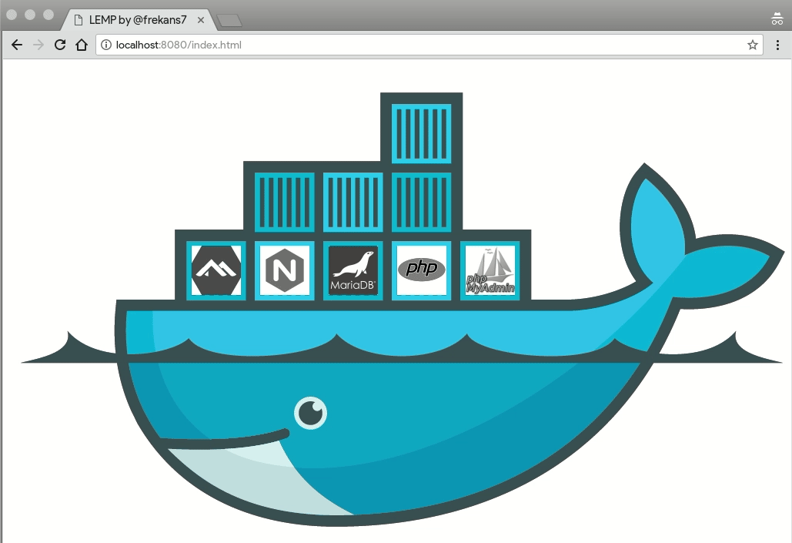

# LEMP Stack

A simple LEMP stack using the *Official* Docker Repository for Alpine Linux, Nginx, MariaDB, PHP 8.4 and phpMyAdmin.

## Stack

| Service | Image |
|---|---|
| Web Server | `nginx:stable-alpine` |
| PHP | `php:8.4-fpm-alpine` |
| Database | `mariadb:lts` |
| DB Admin | `phpmyadmin/phpmyadmin` |

## Getting Started

### 1. Copy the environment file and set your passwords

```bash
cp .env.example .env
```

> Edit `.env` and change the default passwords before starting.

### 2. Start LEMP

```bash
docker compose up -d
```

### 3. Stop LEMP

```bash
docker compose stop
```

### 4. Remove LEMP

```bash
docker compose down
```

### 5. Remove LEMP with volumes (deletes database data)

```bash
docker compose down -v
```

## Access

| Service | URL |
|---|---|
| Web (PHP/HTML) | http://localhost:8080 |
| phpMyAdmin | http://localhost:8183 |

> Ports can be customized via the `.env` file (`NGINX_PORT`, `PMA_PORT`).

---



