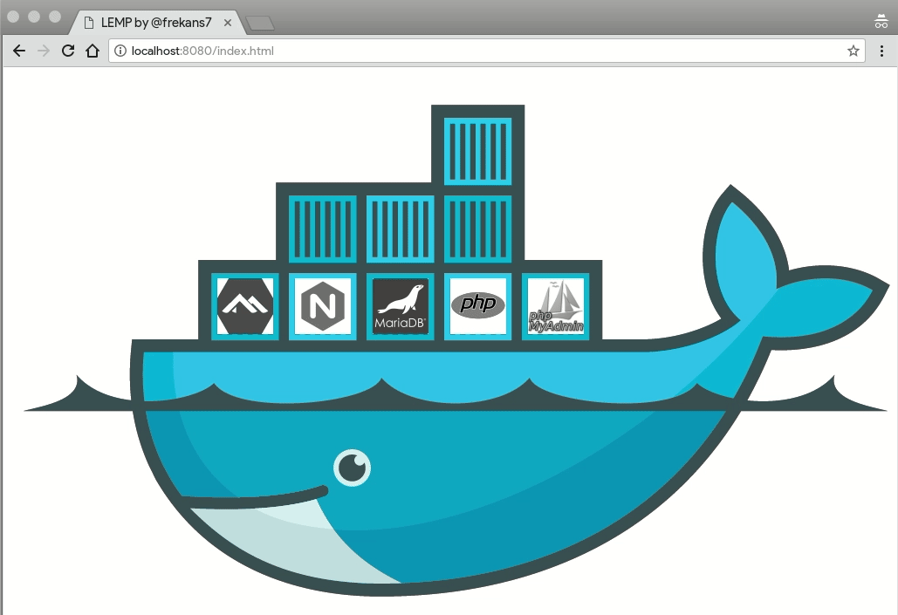

# LEMP Stack

<!-- hy-mt2-i18n:start -->
[English](./README.md) | [中文](./README_zh-CN.md) | [日本語](./README_ja.md) | **Español**
<!-- hy-mt2-i18n:end -->


[](LICENSE)



Una sencilla pila LEMP que utiliza el repositorio *oficial* de Docker para Alpine Linux, Nginx, MariaDB, PHP 8.4 y phpMyAdmin.

## Pila

| Servicio | Imagen |
|---|---|
| Servidor web | `nginx:1.30.4-alpine` |
| PHP | `php:8.4.11-fpm-alpine` |
| Base de datos | `mariadb:12.3.2` |
| Administrador de BD | `phpmyadmin:5.2.3` |

## Primeros pasos

### 1. Clona el repositorio

```bash
git clone https://github.com/frekans7/docker-compose-lemp.git
cd docker-compose-lemp
```

### 2. Copia el archivo de entorno y establece tus contraseñas

```bash
cp.env.example.env
```

> [!ADVERTENCIA]
> **Riesgo de seguridad:** DEBES cambiar las contraseñas predeterminadas `change-me` de `MYSQL_ROOT_PASSWORD` y `MYSQL_PASSWORD` en el archivo `.env` antes de desplegarlo en cualquier entorno accesible públicamente.

### 3. Inicia LEMP

```bash
docker compose up -d
```

### 4. Detén LEMP

```bash
docker compose stop
```

### 5. Elimina LEMP

```bash
docker compose down
```

### 6. Elimina LEMP con volúmenes (elimina los datos de la base de datos)

```bash
docker compose down -v
```

## Variables de entorno

Las siguientes variables están disponibles en el archivo `.env` para su configuración:

| Variable | Descripción | Valor predeterminado |
|---|---|---|
| `NGINX_VERSION` | Versión de la imagen Docker para Nginx | `1.30.4-alpine` |
| `PHP_VERSION` | Versión de la imagen Docker para PHP-FPM | `8.4.11-fpm-alpine` |
| `MARIADB_VERSION` | Versión de la imagen Docker para MariaDB | `12.3.2` |
| `PMA_VERSION` | Versión de la imagen Docker para phpMyAdmin | `5.2.3` |
| `MYSQL_ROOT_PASSWORD` | Contraseña de root para MariaDB | `change-me` |
| `MYSQL_DATABASE` | Nombre de la base de datos predeterminada creada | `lemp` |
| `MYSQL_USER` | Nombre del usuario de la base de datos predeterminado | `lemp` |
| `MYSQL_PASSWORD` | Contraseña del usuario de la base de datos predeterminado | `change-me` |
| `NGINX_PORT` | Puerto del host mapeado al contenedor de Nginx | `8080` |
| `PMA_PORT` | Puerto del host mapeado al contenedor de phpMyAdmin | `8183` |


## Acceso

| Servicio | URL |
|---|---|
| Web (PHP/HTML) | http://localhost:8080 |
| phpMyAdmin | http://localhost:8183 |

> Los puertos se pueden personalizar a través del archivo `.env` (`NGINX_PORT`, `PMA_PORT`).

## Licencia

Este proyecto está licenciado bajo la Licencia MIT; consulta el archivo [LICENSE](LICENSE) para más detalles.
