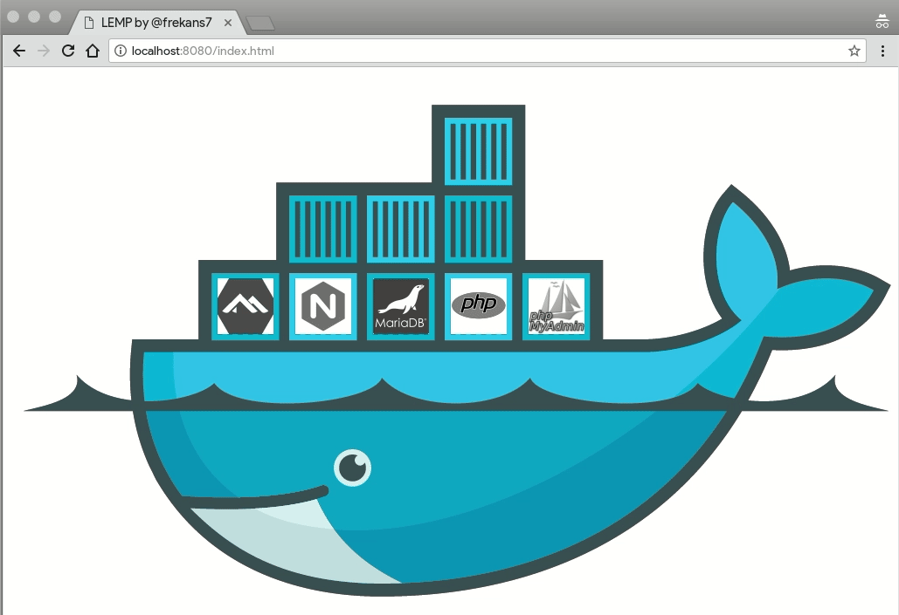

# LEMP Stack

<!-- hy-mt2-i18n:start -->
[English](./README.md) | [中文](./README_zh-CN.md) | **日本語** | [Español](./README_es.md)
<!-- hy-mt2-i18n:end -->


[](LICENSE)



Alpine Linux、Nginx、MariaDB、PHP 8.4、phpMyAdmin向けの*公式*Dockerリポジトリを使用したシンプルなLEMPスタックです。

## スタック構成

| サービス | イメージ |
|---|---|
| Webサーバー | `nginx:1.30.4-alpine` |
| PHP | `php:8.4.11-fpm-alpine` |
| データベース | `mariadb:12.3.2` |
| DB管理ツール | `phpmyadmin:5.2.3` |

## 使い始め方

### 1. リポジトリをクローンする

```bash
git clone https://github.com/frekans7/docker-compose-lemp.git
cd docker-compose-lemp
```

### 2. 環境設定ファイルをコピーし、パスワードを設定する

```bash
cp.env.example.env
```

> [!警告]
> **セキュリティリスク:** 公開環境にデプロイする前に、`.env`ファイル内の`MYSQL_ROOT_PASSWORD`および`MYSQL_PASSWORD`のデフォルト値`change-me`を必ず変更してください。

### 3. LEMPを起動する

```bash
docker compose up -d
```

### 4. LEMPを停止する

```bash
docker compose stop
```

### 5. LEMPを削除する

```bash
docker compose down
```

### 6. ボリュームを含めてLEMPを削除する（データベースデータも削除されます）

```bash
docker compose down -v
```

## 環境変数

設定用に`.env`ファイル内で利用可能な変数は以下の通りです：

| 変数 | 説明 | デフォルト値 |
|---|---|---|
| `NGINX_VERSION` | Nginx用のDockerイメージのバージョン | `1.30.4-alpine` |
| `PHP_VERSION` | PHP-FPM用のDockerイメージのバージョン | `8.4.11-fpm-alpine` |
| `MARIADB_VERSION` | MariaDB用のDockerイメージのバージョン | `12.3.2` |
| `PMA_VERSION` | phpMyAdmin用のDockerイメージのバージョン | `5.2.3` |
| `MYSQL_ROOT_PASSWORD` | MariaDBのルートパスワード | `change-me` |
| `MYSQL_DATABASE` | 作成されるデフォルトデータベースの名前 | `lemp` |
| `MYSQL_USER` | デフォルトのデータベースユーザー名 | `lemp` |
| `MYSQL_PASSWORD` | デフォルトのデータベースユーザーのパスワード | `change-me` |
| `NGINX_PORT` | Nginxコンテナにマッピングされるホストポート | `8080` |
| `PMA_PORT` | phpMyAdminコンテナにマッピングされるホストポート | `8183` |


## アクセス方法

| サービス | URL |
|---|---|
| Web (PHP/HTML) | http://localhost:8080 |
| phpMyAdmin | http://localhost:8183 |

> ポート番号は`.env`ファイル（`NGINX_PORT`、`PMA_PORT`）を通じてカスタマイズできます。

## ライセンス

このプロジェクトはMITライセンスの下で提供されています。詳細は[LICENSE](LICENSE)ファイルをご覧ください。
