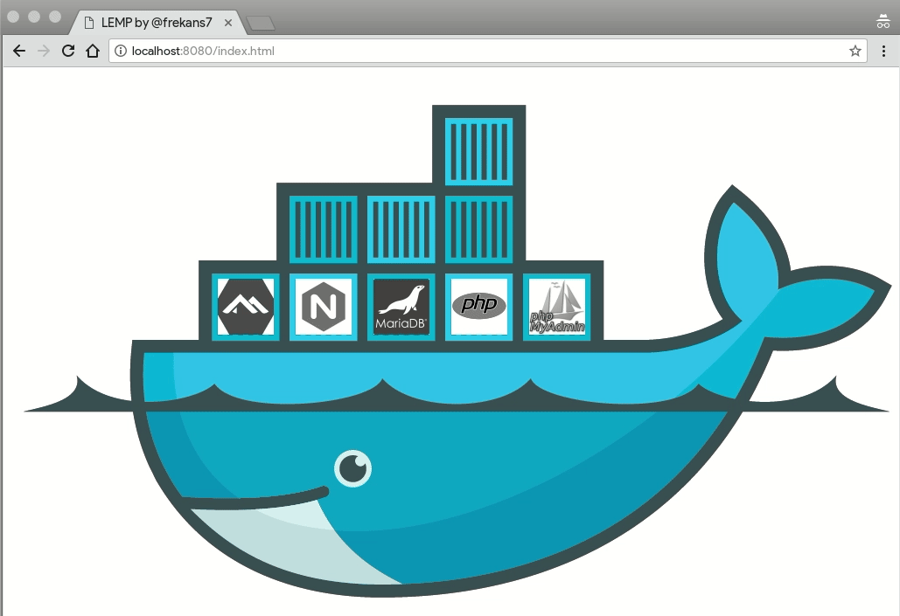

# LEMP Stack

<!-- hy-mt2-i18n:start -->
[English](./README.md) | **中文** | [日本語](./README_ja.md) | [Español](./README_es.md)
<!-- hy-mt2-i18n:end -->


[](LICENSE)



这是一个基于阿尔派Linux官方Docker镜像构建的简单LEMP堆栈，包含Nginx、MariaDB、PHP 8.4以及phpMyAdmin组件。

## 组件组成

| 服务 | 镜像地址 |
|---|---|
| Web服务器 | `nginx:1.30.4-alpine` |
| PHP | `php:8.4.11-fpm-alpine` |
| 数据库 | `mariadb:12.3.2` |
| 数据库管理工具 | `phpmyadmin:5.2.3` |

## 开始使用

### 1. 克隆仓库

```bash
git clone https://github.com/frekans7/docker-compose-lemp.git
cd docker-compose-lemp
```

### 2. 复制环境配置文件并设置密码

```bash
cp.env.example.env
```

> [!警告]
> **安全风险：** 在将应用部署到任何可公开访问的环境之前，您必须更改`.env`文件中`MYSQL_ROOT_PASSWORD`和`MYSQL_PASSWORD`这两个默认的“change-me”密码。

### 3. 启动LEMP服务

```bash
docker compose up -d
```

### 4. 停止LEMP服务

```bash
docker compose stop
```

### 5. 卸载LEMP服务

```bash
docker compose down
```

### 6. 带卷卸载LEMP服务（会删除数据库数据）

```bash
docker compose down -v
```

## 环境变量

在`.env`文件中可以配置以下变量：

| 变量名 | 描述 | 默认值 |
|---|---|---|
| `NGINX_VERSION` | Nginx的Docker镜像版本 | `1.30.4-alpine` |
| `PHP_VERSION` | PHP-FPM的Docker镜像版本 | `8.4.11-fpm-alpine` |
| `MARIADB_VERSION` | MariaDB的Docker镜像版本 | `12.3.2` |
| `PMA_VERSION` | phpMyAdmin的Docker镜像版本 | `5.2.3` |
| `MYSQL_ROOT_PASSWORD` | MariaDB的根用户密码 | `change-me` |
| `MYSQL_DATABASE` | 创建的默认数据库名称 | `lemp` |
| `MYSQL_USER` | 默认数据库用户的用户名 | `lemp` |
| `MYSQL_PASSWORD` | 默认数据库用户的密码 | `change-me` |
| `NGINX_PORT` | 映射到Nginx容器的主机端口 | `8080` |
| `PMA_PORT` | 映射到phpMyAdmin容器的主机端口 | `8183` |


## 访问方式

| 服务 | URL |
|---|---|
| Web界面（PHP/HTML） | http://localhost:8080 |
| phpMyAdmin | http://localhost:8183 |

> 可以通过`.env`文件自定义端口号（`NGINX_PORT`、`PMA_PORT`）。

## 许可证

本项目采用MIT许可证进行授权——详情请参阅[LICENSE](LICENSE)文件。
